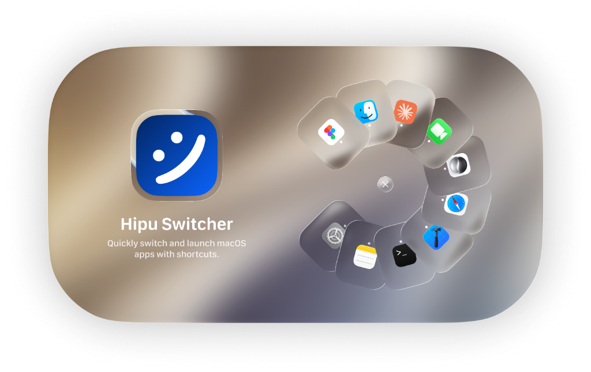
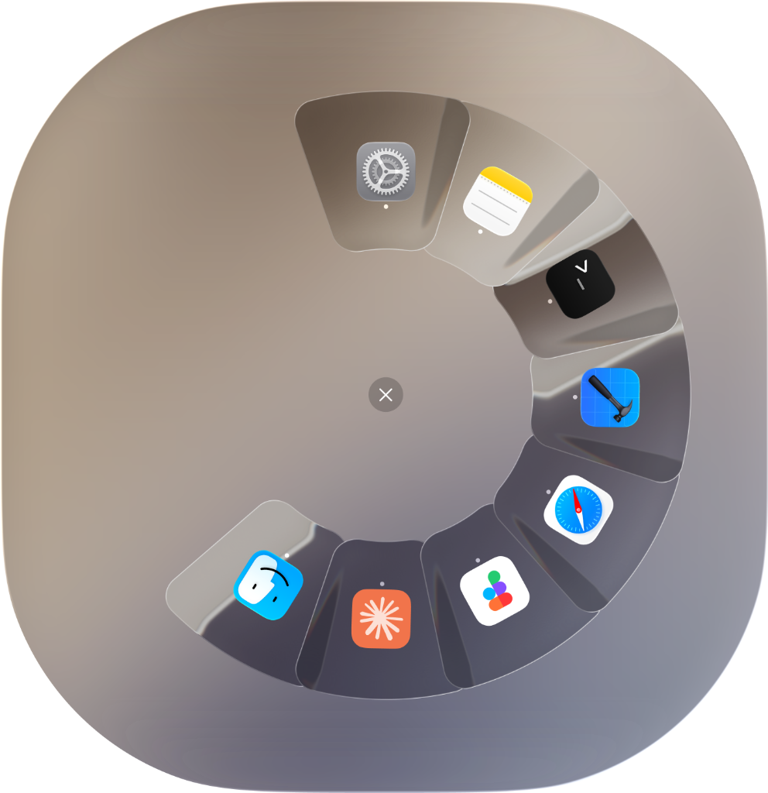
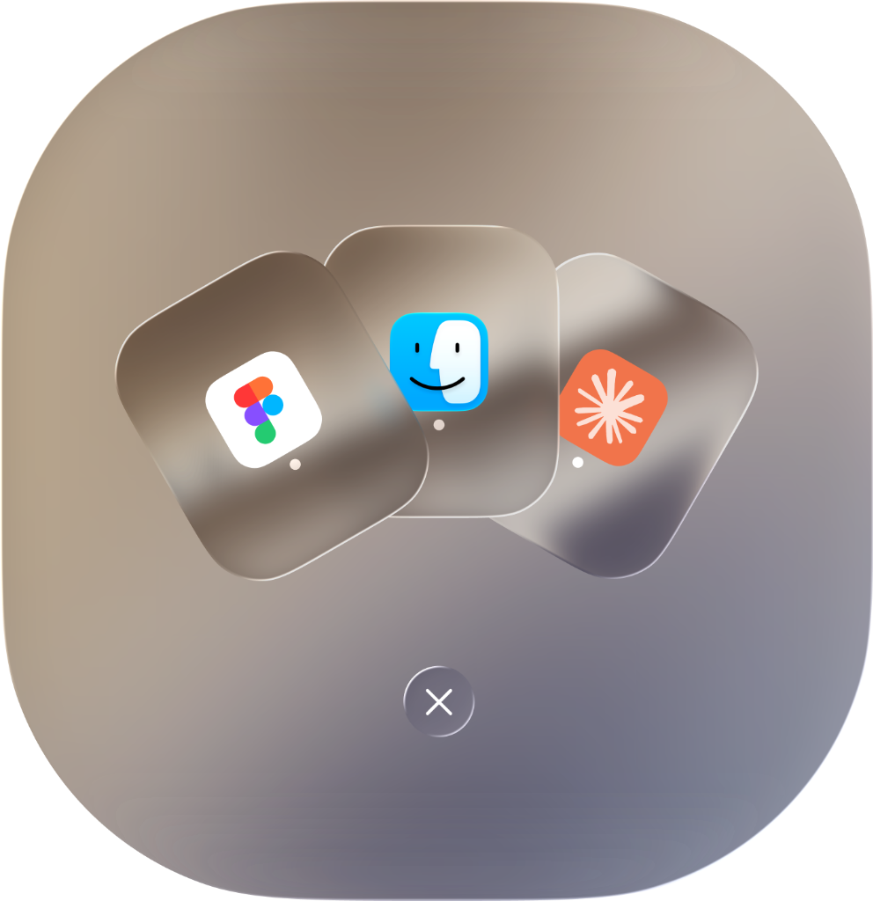
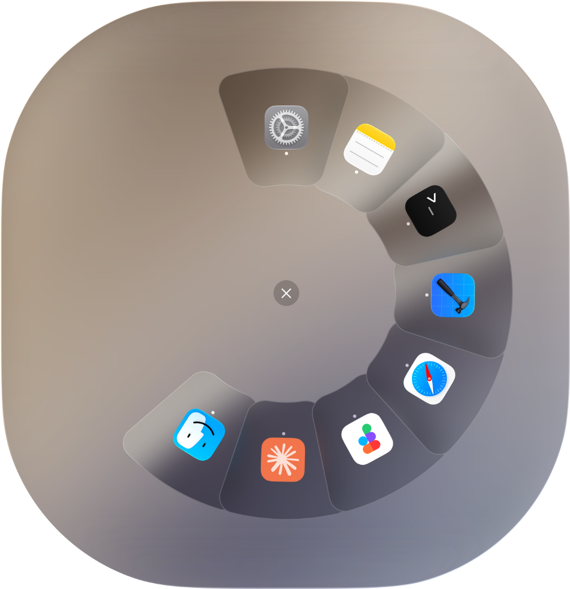
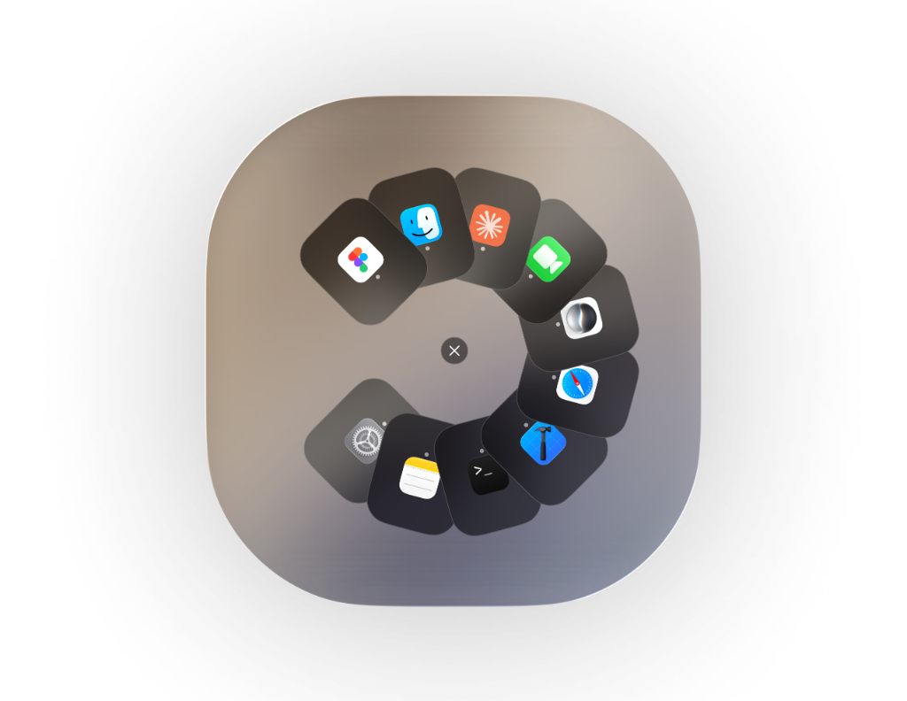
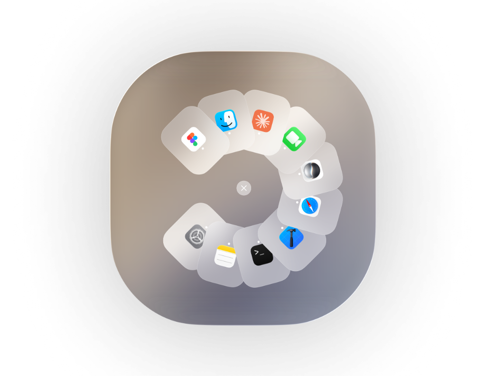
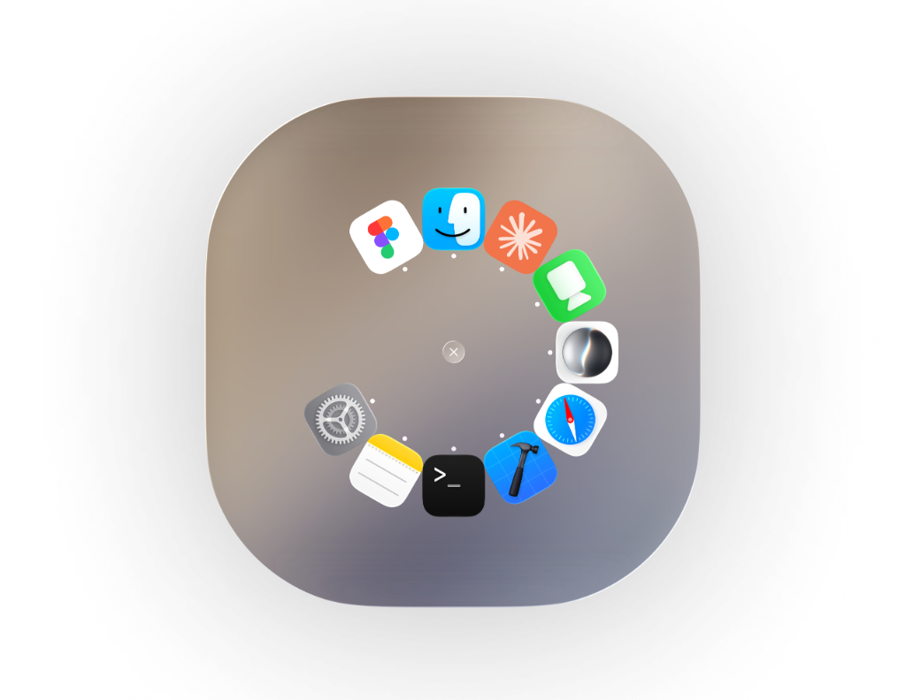

<p align="center">
  
</p>

<h1 align="center">HiPu Switcher</h1>

<p align="center">
  <strong>Chuyển đổi và mở nhanh ứng dụng trên macOS theo dạng cánh quạt &amp; thẻ nổi chuẩn Liquid Glass.</strong><br />
  Phát triển bởi <strong>PhucVang</strong> · Hỗ trợ macOS 14+ (tối ưu cho macOS 26/27 Liquid Glass)
</p>

<p align="center">
  <a href="https://14phucs-netizen.github.io/HiPuSwitcher/">
    
  </a>
  <a href="https://github.com/14phucs-netizen/HiPuSwitcher/releases/latest">
    
  </a>
  
</p>

---

## Giao diện thực tế trên macOS

<p align="center">
  
</p>

---

## Đa phong cách hiển thị

Chuyển đổi tức thì giữa **Liquid Glass**, **Blur-Fan**, **Blur-Rectangle (Sáng / Tối)** và **Non-Background** — tuỳ chỉnh độ đục, viền thẻ, bán kính và lưu cấu hình riêng.

<table>
  <tr>
    <td align="center" width="33%">
      <br />
      <strong>Liquid Glass Fan</strong>
    </td>
    <td align="center" width="33%">
      <br />
      <strong>Liquid Glass Card</strong>
    </td>
    <td align="center" width="33%">
      <br />
      <strong>Blur-Fan</strong>
    </td>
  </tr>
  <tr>
    <td align="center" width="33%">
      <br />
      <strong>Blur Tối</strong>
    </td>
    <td align="center" width="33%">
      <br />
      <strong>Blur Sáng</strong>
    </td>
    <td align="center" width="33%">
      <br />
      <strong>Không nền</strong>
    </td>
  </tr>
</table>

---

## Tính năng chính

- **Kích hoạt mọi nơi:** `fn + ⇧`, nhấn đúp `⇧ / ⌥ / ⌘`, phím tắt tuỳ chỉnh hoặc chuột giữa.
- **Chuyển Space thông minh:** Tự động lướt sang đúng màn hình nền chứa ứng dụng; riêng **Finder** luôn mở *Tải về* ngay tại Space hiện tại.
- **Song ngữ Tiếng Việt / English:** Chuyển đổi tức thì không cần khởi động lại.
- **Siêu nhẹ & Tự cập nhật:** 100% Swift/SwiftUI gốc (`3.0 MB`), không tracking, tự kiểm tra bản mới qua GitHub Releases.

---

## Tải về & Cài đặt

Tải bản mới nhất tại [**Trang chủ**](https://14phucs-netizen.github.io/HiPuSwitcher/) hoặc [**Releases**](https://github.com/14phucs-netizen/HiPuSwitcher/releases/latest):

1. Mở file `.dmg` và kéo **HiPu Switcher** vào thư mục **Applications**.
2. Nếu macOS Gatekeeper hỏi ở lần mở đầu tiên, vào **Cài đặt hệ thống → Quyền riêng tư & Bảo mật → Vẫn mở (Open Anyway)** đúng 1 lần.
3. Bấm **Cấp quyền** trên màn hình chào mừng và bật **HiPuSwitcher** trong mục **Trợ năng (Accessibility)**.

## Build từ mã nguồn

```bash
./build_app.sh
./build_dmg.sh
```
