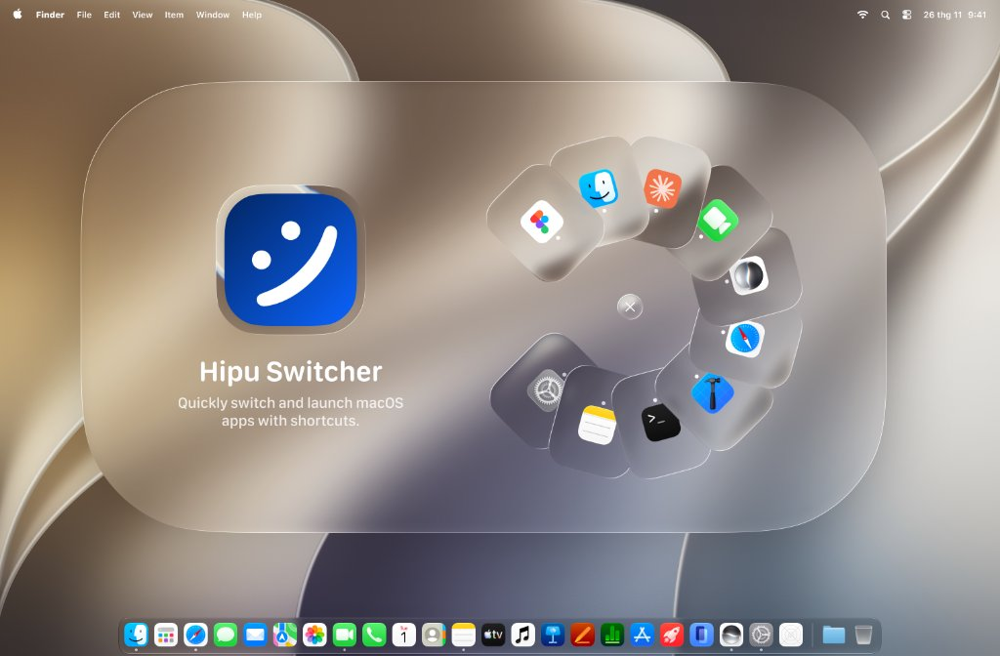
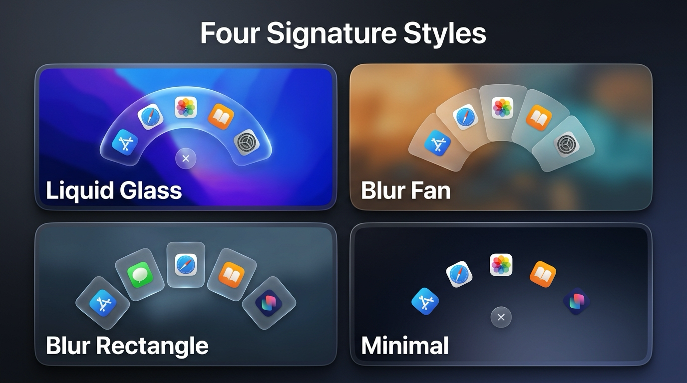
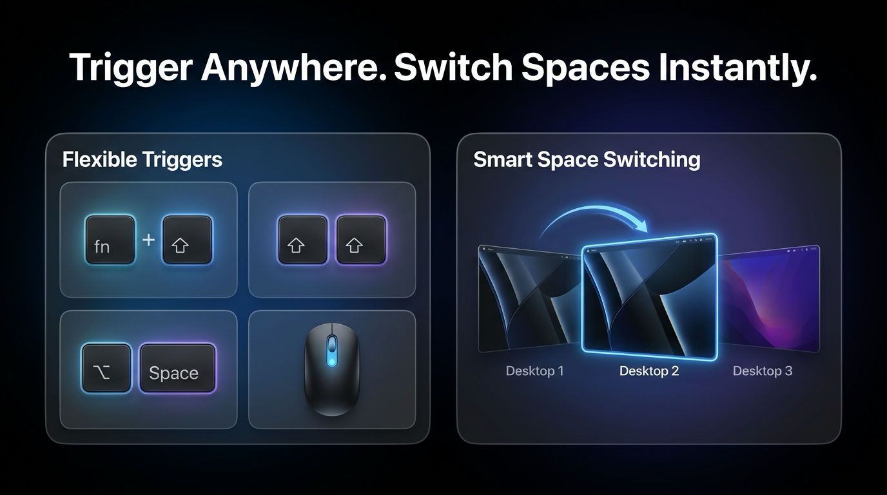

<p align="center">
  
</p>

<h1 align="center">HiPu Switcher</h1>

<p align="center">
  <strong>Chuyển đổi và mở nhanh ứng dụng trên macOS theo dạng cánh quạt &amp; thẻ nổi chuẩn Liquid Glass.</strong><br />
  Phát triển bởi <strong>PhucVang</strong> · Hỗ trợ macOS 14+ (tối ưu cho macOS 26/27 Liquid Glass)
</p>

<p align="center">
  <a href="https://github.com/14phucs-netizen/HiPuSwitcher/releases/latest">
    
  </a>
  
  
</p>

---

## Tải về & Cài đặt

Tải bản cài đặt mới nhất (`.dmg`) tại trang [**Releases**](https://github.com/14phucs-netizen/HiPuSwitcher/releases/latest):

1. Mở file `HiPuSwitcher-1.0.0.dmg`.
2. Kéo **HiPu Switcher** vào thư mục **Applications**.
3. Mở ứng dụng từ Applications và cấp quyền **Trợ năng (Accessibility)** ở màn hình thiết lập lần đầu.

> **Lưu ý khi mở lần đầu:** Nếu macOS hiển thị cảnh báo Gatekeeper, vào **Cài đặt hệ thống → Quyền riêng tư & Bảo mật → Vẫn mở (Open Anyway)** đúng 1 lần duy nhất.

---

## 4 phong cách hiển thị có sẵn

Chuyển đổi tức thì giữa **Liquid glass**, **Blur-Fan**, **Blur-Rectangle** và **Non-Background**, đồng thời tuỳ chỉnh sâu độ đục, viền thẻ, bán kính, góc xoè và lưu cấu hình riêng của bạn.

<p align="center">
  
</p>

---

## Kích hoạt linh hoạt & Chuyển Space thông minh

- **Đa dạng cách kích hoạt:** Phím tắt tuỳ chỉnh, `fn + Shift`, nhấn đúp `⇧` / `⌥` / `⌘`, hoặc chuột giữa.
- **Chuyển Space tự nhiên:** Nhấn vào ứng dụng đang mở ở màn hình nền khác sẽ tự động lướt sang đúng Space đó; riêng **Finder** luôn mở thẳng thư mục *Tải về* ngay tại Space bạn đang làm việc.
- **Song ngữ Tiếng Việt / English:** Chuyển đổi ngôn ngữ tức thì không cần khởi động lại.
- **Kiểm tra cập nhật:** Tự động kiểm tra bản mới qua GitHub Releases / `latest.json`.

<p align="center">
  
</p>

---

## Build từ mã nguồn

Yêu cầu: macOS 14+ (khuyến nghị macOS 26/27 cho hiệu ứng Liquid Glass đầy đủ) và Xcode / Swift 5.9+.

```bash
./build_app.sh
./build_dmg.sh
```
